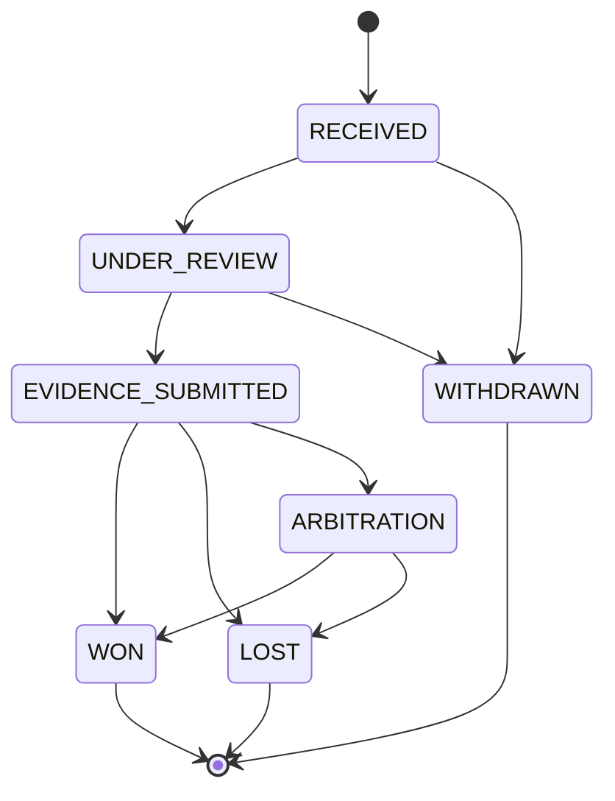
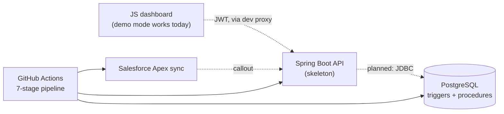

# MerchantLens

A payment **settlement, reconciliation and chargeback** project built around a PostgreSQL database. The
database enforces the rules (chargeback lifecycle, audit trail, settlement math). A small Java API, a
dependency-free JavaScript dashboard, a Salesforce Apex sync and a CI/CD pipeline are built around it.

All data in this repository is **synthetic seed data**. Nothing here has processed real payments.
Full design, diagrams and trade-offs: **[docs/ARCHITECTURE.md](docs/ARCHITECTURE.md)**.

## Status at a glance

| Component | Status | Evidence |
|---|---|---|
| **Database** (schema, triggers, procedures, queries) | Working | Loads cleanly on PostgreSQL 16; 24 pgTAP tests in `devsecops/db_tests.sql` |
| **Dashboard** (`dashboard/`) | Working in demo mode; live mode needs the API | 24 `node:test` unit tests, no dependencies |
| **Java API** (`java-api/`) | Skeleton: routes, role rules and DTO exist; service layer is a stub and the JWT filter authenticates no one | No tests yet; no database wiring |
| **Salesforce sync** (`salesforce/`) | Implemented; needs your own sandbox | 4 Apex tests with mock callouts |
| **CI/CD** (`.github/workflows/`) | Three workflows defined; the deploy stage needs your secrets | n/a |

Known problems are listed openly in [Known issues](#known-issues).

## What problem it explores

Settlement and chargeback work tends to fail in the same few places. Each row is a small version of a fix.

| Problem | What MerchantLens does |
|---|---|
| Chargeback status can be changed to an invalid state | A `BEFORE UPDATE` trigger enforces the lifecycle (diagram below), so no service or manual `psql` session can skip a step |
| No record of who changed financial data | A trigger writes an audit row for every insert, update and delete on six financial tables, regardless of which client made the change |
| Chargeback ratios only noticed at month end | A rolling 7-day chargeback-ratio query per merchant with an alert flag |
| Fee and settlement math done in application code | PL/pgSQL functions compute MDR fees and run settlement in integer paise (no floating point) |
| Dispute analysts switching between tools | An Apex class upserts disputes into Salesforce Cases; a dispute in `ARBITRATION` sets the Case status to `Escalated` |
| Analysts need disputes and ratios at a glance | A dashboard lists disputes, shows the ratio per merchant, and offers *Escalate* only where the lifecycle allows it |
| Direct database access from other systems | A Spring Boot API is meant to sit in front of the database (JWT, DTOs). Today it is a skeleton |

### Dispute lifecycle



This is the exact map in `triggers/02_dispute_fsm.sql`. Any other transition fails with SQLSTATE `P0001`.

## Quick start

Pick the track you care about. The database and dashboard need no accounts, cloud services or API keys.

### 1. Database (about a minute)

Requires PostgreSQL 16 (what CI uses) and `psql`.

```bash
createdb merchantlens

# Applies schema, indexes, triggers, procedures and seed data in dependency order
for file in schema/*.sql indexes/*.sql triggers/*.sql procedures/*.sql seed/*.sql; do
  psql -v ON_ERROR_STOP=1 -q -d merchantlens -f "$file"
done
```

Then try it:

```bash
# Rolling 7-day chargeback ratio, settlement lag, GMV by payment method, payout on-time rate
psql -d merchantlens -f queries/02_merchant_analytics.sql

# The lifecycle as data
psql -d merchantlens -c "SELECT * FROM v_dispute_fsm_transitions"

# Watch the trigger reject an invalid jump: the seeded dispute is UNDER_REVIEW, which cannot go straight to WON
psql -d merchantlens -c "UPDATE disputes SET status = 'WON'"

# The database tests (needs the pgTAP extension, for example the postgresql-16-pgtap package)
psql -d merchantlens -f devsecops/db_tests.sql
```

Sample output of the rolling-ratio query on the bundled seed (dates are relative to the day you load it):

```
   merchant_name    |  txn_date  | rolling_captures | rolling_disputes | rolling_gross_inr | cb_ratio_pct | cb_status
--------------------+------------+------------------+------------------+-------------------+--------------+-----------
 Apollo Pharmacy    | 2026-11-06 |                1 |                0 |            420.00 |         0.00 | OK
 D-Mart             | 2026-11-08 |                1 |                0 |           5800.00 |         0.00 | OK
 Zudio Retail       | 2026-11-10 |                3 |                0 |           4248.00 |         0.00 | OK
 ...
```

The seed is small (about 60 rows across 8 tables), so the ratios are all zero. It exists so every query and
procedure has something to run against. Merchant names are real brand names used only as labels; no data comes
from those companies.

### 2. Dashboard (demo mode, no API needed)

Requires Node 22 or newer. There is nothing to `npm install`.

```bash
cd dashboard
npm test                                   # 24 unit tests
npm start                                  # http://localhost:3000, demo mode
```

Demo mode is on whenever the JWT field is empty. To use it against the API, run
`API_URL=http://localhost:8080 npm start` and paste a JWT into the page. The dev server proxies `/api`, so CORS
is not involved. The API's service layer is a stub, so live mode shows no disputes until that is implemented.

What it does:

- Lists disputes with status and merchant filters, plus open/closed counts, and shows the chargeback ratio per
  merchant with alerting merchants first.
- Shows **Escalate** only for `EVIDENCE_SUBMITTED` disputes, the only state the database allows to move to
  `ARBITRATION`. The trigger still enforces this; the button just avoids offering an action that would fail.
- Renders API data with `textContent`, never `innerHTML`, under a strict Content-Security-Policy. The JWT lives
  only in the input field, not in browser storage.
- `dashboard/src/fsm.js` mirrors the lifecycle trigger, and a test parses `triggers/02_dispute_fsm.sql` and fails
  if the two ever differ.

### 3. Java API (skeleton)

Requires JDK 17 and Maven. This is a runnable shell, not a working service yet.

```bash
cd java-api
mvn -B package        # compile and package
mvn spring-boot:run   # run the skeleton (Spring Boot's default port, 8080)
```

What exists: the `/api/v1/disputes` routes with role rules, the `DisputeResponse` DTO, security headers and a
stub service. What does not: database access (there is no datasource or JDBC dependency), token validation
(`JwtAuthenticationFilter` is a placeholder, so protected routes stay closed), and tests. See
[docs/ARCHITECTURE.md](docs/ARCHITECTURE.md#6-application-layers) for the endpoint table.

### 4. Salesforce (needs a sandbox)

Requires a Salesforce sandbox, a Named Credential called `MerchantLens_API` that points at the API, and an
External ID field `MerchantLens_Dispute_ID__c` on Case.

```bash
sf org login web --alias merchantlens-sandbox

sf project deploy start \
  --source-dir salesforce/force-app \
  --target-org merchantlens-sandbox \
  --test-level RunLocalTests
```

`MerchantDisputeSync.syncRecentDisputes()` fetches the last 24 hours of disputes and upserts them as Cases on
the external ID, so re-running it never duplicates Cases. The class is written to be run by Scheduled Apex, but
no scheduler class is included, so you would add one.

## Architecture at a glance



Solid arrows work today; dashed arrows are the intended wiring. The database layer is complete and
self-contained, and it is where the business rules live. See
**[docs/ARCHITECTURE.md](docs/ARCHITECTURE.md)** for every layer in detail.

## Reading guide: five minutes in the code

1. [`triggers/02_dispute_fsm.sql`](triggers/02_dispute_fsm.sql): the lifecycle guard, about 100 lines. Start here.
2. [`triggers/01_audit_trigger.sql`](triggers/01_audit_trigger.sql): one generic audit function attached to six tables.
3. [`procedures/01_run_settlement.sql`](procedures/01_run_settlement.sql): batch, line items, totals and payout in one function, using row locks.
4. [`queries/02_merchant_analytics.sql`](queries/02_merchant_analytics.sql): the rolling chargeback ratio with CTEs and window functions.
5. [`dashboard/test/fsm.test.mjs`](dashboard/test/fsm.test.mjs): the test that keeps the JavaScript copy of the lifecycle honest.

## Project structure

```
merchant-lens/
├── schema/          PostgreSQL schema: 14 tables, 12 enum types
├── indexes/         Composite, partial, expression, covering and BRIN indexes
├── triggers/        Audit log + chargeback lifecycle trigger
├── procedures/      Settlement run, dispute escalation, fee calculation
├── queries/         Reconciliation, merchant analytics, rankings and cohorts
├── seed/            Small synthetic seed set (about 60 rows)
├── devsecops/       pgTAP tests used by the CI database stage
├── java-api/        Spring Boot REST API (skeleton)
├── dashboard/       JavaScript dashboard (Node built-ins only), 24 tests
├── salesforce/      Apex sync + tests
├── .github/workflows/
│   ├── ci.yml                    Quick schema + trigger smoke test
│   ├── devsecops-pipeline.yml    7-stage CI/CD pipeline
│   └── dashboard-ci.yml          Dashboard tests, only when dashboard code or the lifecycle trigger changes
└── docs/
    ├── ARCHITECTURE.md           Design, diagrams, decisions, known issues
    └── schema_diagram.md         Entity relationships and table descriptions
```

## CI/CD pipeline (7 stages)

The stages are `devsecops-pipeline.yml`. `ci.yml` is a lighter smoke test and `dashboard-ci.yml` runs the
dashboard tests, so neither changes the stages below.

```
Push / PR
    |
    v
[1] Secret scan          Gitleaks + TruffleHog
[2] SAST                 SpotBugs (Java), OWASP Dependency-Check, SQLFluff (SQL style lint)
[3] DB validation        Schema applied to an ephemeral Postgres, pgTAP tests run
[4] Java tests           Maven tests, JaCoCo coverage gate (threshold: `jacoco.minimum` in pom.xml)
[5] Salesforce validate  SF CLI check-only deploy + PMD static analysis of Apex
[6] DAST (main only)     OWASP ZAP baseline scan against the API started on the runner
[7] Deploy               DB migrations, Docker image push, Salesforce deploy, Slack notification
```

Stages 1 to 4 run in sequence. Salesforce validation and DAST both start after the Java tests, and deploy waits
for both. Blocking conditions: a secret finding, SpotBugs, dependency vulnerabilities at CVSS 7 or above,
coverage under `jacoco.minimum`, PMD findings at severity 3 or worse, or ZAP findings at FAIL level (ZAP
warnings are reported in the artifact but do not block). The step is labelled "70% coverage gate", but the
threshold is currently 0.00 (see Scope and limits). Because the API is a skeleton, DAST currently scans a service
whose routes are all closed, so it exercises headers and configuration rather than business logic.

## Design decisions

Short versions; trade-offs are in [docs/ARCHITECTURE.md](docs/ARCHITECTURE.md#8-design-decisions).

1. **Lifecycle rules in a trigger, not application code.** Java, Apex and a manual SQL session are all held to
   the same rules.
2. **Audit log written by the database.** Changes made through the API, Apex or `psql` are all recorded. It is an
   audit trail, not a tamper-proof one (see Known issues).
3. **Money in integer paise.** No floating-point rounding in fees, settlement or payouts.
4. **API in front of the database.** Other systems should not share database credentials; the API authenticates
   callers and returns DTOs so table structure is not exposed. This is the target design, not yet implemented.
5. **Idempotent Salesforce sync.** Cases are upserted on an external ID, so re-running after a failure creates no
   duplicates.
6. **Security checks as pipeline gates.** Secret scanning, static analysis, dependency checks and a dynamic scan
   run before deploy.

## Known issues

Listed so a reviewer does not have to find them.

| Issue | Effect | Fix direction |
|---|---|---|
| `escalate_overdue_disputes()` selects overdue `UNDER_REVIEW` disputes, but the lifecycle trigger only allows `ARBITRATION` from `EVIDENCE_SUBMITTED` | One overdue `UNDER_REVIEW` dispute makes the call fail with `P0001`, and nothing is escalated in that run. The pgTAP suite only checks the function exists | Select only `EVIDENCE_SUBMITTED`, or define a different outcome for overdue `UNDER_REVIEW`; add the regression test in the architecture doc |
| Apex status map has no entry for `EVIDENCE_SUBMITTED` or `WITHDRAWN` | They fall back to Case status `New`; tests only cover `WON` | Map them explicitly and test each lifecycle state |
| `audit_log` is append-only by convention only | No `REVOKE`, rule or trigger blocks `UPDATE`/`DELETE` on it | Revoke write access from application roles; consider a hash chain |
| Audit trigger covers six tables | `fee_config`, `merchants`, `terminals` and `dispute_evidence` changes are not logged | Attach the trigger where an audit trail is required |
| Comments in `seed/01_seed_data.sql` and `run_settlement` are out of date | The seed header says about 1,200 rows (it is about 60); the settlement header says SERIALIZABLE (it relies on row locks) | Update the comments |

## Scope and limits

- **Synthetic data only.** Reported figures are not real merchant or payment data.
- **The API's service layer is a stub.** Read endpoints return empty results, `escalate` answers 501, and the JWT
  filter authenticates no one. The dashboard therefore ships with a demo mode.
- **Coverage gate is wired, not yet strict.** `jacoco.minimum` in `java-api/pom.xml` is 0.00 because the API has
  no tests yet; raise it to 0.70 once they exist.
- **Salesforce sync needs a sandbox**, a Named Credential and an External ID field on Case. It is not a hosted demo.
- **Deploy stage needs configuration:** your registry, Salesforce and Slack secrets.
- **Rate limiting and rollback are not implemented.** Authentication, CORS and HSTS are in `SecurityConfig`;
  request throttling and automated rollback would be next steps.
- **Not a production payment system.** It does not handle card data and has not been reviewed against PCI-DSS or
  RBI requirements.

## Troubleshooting

| Symptom | Fix |
|---|---|
| `psql: database "merchantlens" does not exist` | Run `createdb merchantlens` first |
| `permission denied to create extension "pgtap"` or `extension "pgtap" is not available` | Install the pgTAP package for your PostgreSQL version and run as a superuser, or skip `db_tests.sql` |
| `type "..." already exists` when re-running setup | The schema is not re-runnable. Use `dropdb merchantlens && createdb merchantlens` and start again |
| `npm test`: `node --test` not found or syntax errors | Check `node --version` is 22 or newer |
| Dashboard shows "Could not reach the API" | The API is not running; clear the JWT field to use demo mode |
| `mvn` build fails offline | The first build downloads dependencies from Maven Central; use a network that can reach it |

## Skills demonstrated

| Layer | Skill |
|---|---|
| Database | 14-table normalized schema, CTEs, window functions, PL/pgSQL procedures, triggers, partial, expression and covering indexes |
| JavaScript | Dependency-free ES modules, `node:test`, safe DOM rendering, CSP, a same-origin dev proxy, a test that guards against drift from the SQL trigger |
| Java | Spring Boot REST layout, Spring Security configuration (CORS, HSTS, method-level roles), DTO pattern, JaCoCo gate. JWT validation and persistence are not yet built |
| Salesforce | Apex HTTP callouts, Named Credentials, `with sharing`, idempotent upsert, mock callouts in tests |
| CI/CD | 7-stage GitHub Actions pipeline plus a path-filtered dashboard workflow, SAST, DAST, pgTAP database tests, secret scanning |
| Domain | Payments reconciliation, chargeback lifecycle, MDR fee computation, settlement lag analytics |
