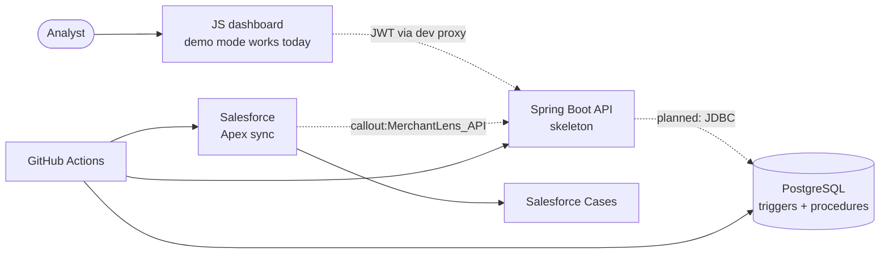
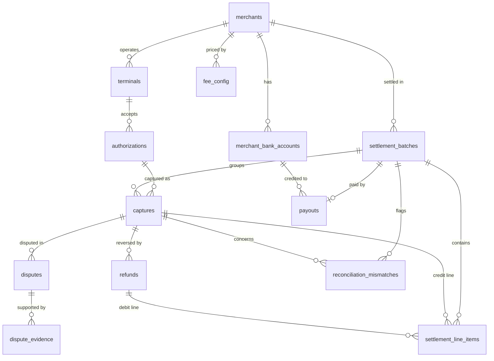
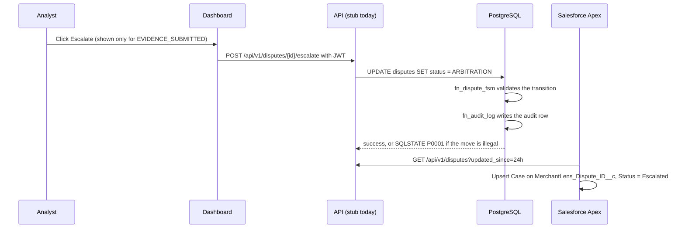
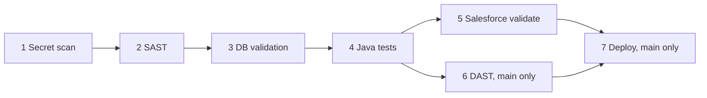

# MerchantLens architecture

How the system is built and why. It assumes you have skimmed the [README](../README.md). File and object names
are real, so you can follow along in the code.

**Contents:**
[1 Scope](#1-scope-and-status) ·
[2 Overview](#2-system-overview) ·
[3 Data model](#3-data-model) ·
[4 Lifecycle](#4-dispute-lifecycle-across-layers) ·
[5 Database](#5-database-mechanisms) ·
[6 Application layers](#6-application-layers) ·
[7 CI/CD](#7-cicd-pipeline) ·
[8 Decisions](#8-design-decisions) ·
[9 Testing](#9-verification-and-testing) ·
[10 Known issues](#10-known-issues-and-limitations) ·
[11 Conventions](#11-conventions-and-extension-points) ·
[12 References](#12-references)

---

## 1. Scope and status

MerchantLens explores the back office of a payment acquirer: closing settlement batches, computing merchant
fees, reconciling, and tracking chargebacks. The **database is the finished, tested core**. The layers around
it are at different stages, and this document says which is which.

| Layer | Status | Notes |
|---|---|---|
| PostgreSQL (schema, triggers, procedures, queries) | Complete and tested | 14 tables, 7 triggers (2 trigger functions), 4 procedures, 26 named indexes |
| JavaScript dashboard | Complete in demo mode | Live mode waits on the API |
| Java API | Skeleton | Routes, role rules, DTO, security headers. Stub service; placeholder JWT filter |
| Salesforce Apex sync | Implemented | Needs a sandbox; no scheduler class included |
| CI/CD | Defined | Three workflows; deploy needs secrets |

**Out of scope:** card data handling, clearing files from card networks, real payout rails (NEFT/IMPS), PCI-DSS
or RBI compliance work, and any production deployment.

## 2. System overview



Solid arrows work today. Dashed arrows are the intended wiring and depend on the API's service layer, which is
not built yet. Because the rules live in the database, any client that eventually connects (the API, Apex through
the API, or an operator in `psql`) is held to the same lifecycle and audited the same way.

## 3. Data model



`audit_log` has no foreign keys on purpose: it stores `table_name` and `record_id` as text, so one table can
record changes from any audited table, including deleted rows.

| Group | Tables | Purpose |
|---|---|---|
| Merchant setup | `merchants`, `merchant_bank_accounts`, `terminals`, `fee_config` | Who is paid, where, through which devices, at what rate |
| Payment flow | `authorizations`, `captures`, `refunds` | Reservation, actual fund movement, reversal |
| Settlement | `settlement_batches`, `settlement_line_items`, `payouts`, `reconciliation_mismatches` | Grouping into batches, one payout per batch, discrepancy tracking |
| Disputes and audit | `disputes`, `dispute_evidence`, `audit_log` | Chargebacks, supporting documents, change history |

### Conventions

- **Money is integer paise** (`BIGINT`), so fee and settlement math has no floating-point rounding. Rates are
  integer basis points (`mdr_bps`).
- **UUID primary keys** everywhere except `audit_log`, which uses `BIGSERIAL` because it is an append-only
  sequence.
- **`TIMESTAMPTZ`** for all times. Reporting indexes use the `Asia/Kolkata` zone in their expressions.
- **Generated columns** keep derived amounts consistent: `captures.net_amount_paise`,
  `settlement_batches.net_payable_paise` and `reconciliation_mismatches.delta_paise`.
- **Enum types** (12) back every status column. `dispute_evidence.evidence_type` uses a `CHECK` list instead.
- **Soft delete** through `is_active` on `merchants` and `terminals`.

`docs/schema_diagram.md` has the per-table descriptions.

## 4. Dispute lifecycle across layers

Three places encode the lifecycle. Only one is the source of truth.

| Where | Role | Kept honest by |
|---|---|---|
| `triggers/02_dispute_fsm.sql` | **Source of truth.** Rejects invalid transitions | pgTAP tests |
| `dashboard/src/fsm.js` | UI mirror so the page only offers legal actions | `fsm.test.mjs` parses the SQL and fails on drift |
| `MerchantDisputeSync.mapDisputeStatusToCaseStatus` | Maps dispute status to Case status | Partial: see [section 10](#10-known-issues-and-limitations) |



The API step is the part that is not built: today `escalate` answers 501. The database and Salesforce halves
work independently of it.

## 5. Database mechanisms

### 5.1 Lifecycle trigger (`fn_dispute_fsm`)

- `BEFORE UPDATE OF status ON disputes`, per row. The allowed next states live in one `JSONB` map.
- A no-op update (same status) passes. A move out of `WON`, `LOST` or `WITHDRAWN` is rejected as terminal. Any
  move not in the map is rejected. Both raise SQLSTATE `P0001` with a message that lists the allowed states.
- On entering a terminal state it sets `resolved_at = NOW()`, so no caller has to remember to.
- **Not guarded:** inserting a dispute directly in any status, and deleting one. A superuser can also disable
  the trigger. It protects against bugs and shortcuts, not against someone with schema ownership.
- `v_dispute_fsm_transitions` exposes the same map as a queryable view.

### 5.2 Audit trigger (`fn_audit_log`)

- `AFTER INSERT OR UPDATE OR DELETE`, per row, attached to six tables: `authorizations`, `captures`, `refunds`,
  `settlement_batches`, `payouts` and `disputes`.
- Stores the table, operation, record id, `session_user` (the login role, even after `SET ROLE`), timestamp, and
  the old and new row as `JSONB`.
- Finds each table's primary-key column from the catalog (`pg_index`) rather than guessing a name. An earlier
  name-based guess produced `UNKNOWN` record ids for tables such as `disputes`, which is why the lookup exists.
- Declared `SECURITY DEFINER` so it can write to `audit_log` even when the caller cannot.
- `v_recent_audit` shows the last 24 hours and, for updates, only the fields that changed.
- **Cost:** every write on an audited table writes a second row containing full JSON. Fine here; at the volumes
  `schema_diagram.md` sketches it would call for partitioning and retention rules (a BRIN index on
  `changed_at` is already in place).

### 5.3 Settlement run (`run_settlement(merchant, date)`)

Returns the id of the batch. Steps, in code order:

1. Reject an unknown or inactive merchant (`P0002`).
2. Open the day's batch with `INSERT ... ON CONFLICT DO NOTHING`, then lock it with `FOR UPDATE`. If it is
   already closed, raise `P0003`.
3. Lock the merchant's `PENDING` captures with `FOR UPDATE SKIP LOCKED`; for each, add a `CREDIT` line item and
   mark the capture `SUBMITTED`.
4. If nothing was pending, leave the batch `OPEN` and return.
5. Roll in `PROCESSING` refunds for the captures just submitted as `DEBIT` lines and mark them `COMPLETED`.
6. Close the batch with gross, fee and refund totals.
7. Schedule a payout at `batch_date + merchant.settlement_cycle_days` to the verified primary bank account
   (a warning if there is none; `ON CONFLICT (batch_id) DO NOTHING` keeps it to one payout per batch).

Things worth knowing:

- **Fees must exist before settlement.** `run_settlement` reads `captures.fee_amount_paise`; it does not compute
  it. On the seed data the pgTAP run reports `fees=₹0.00` because no fee has been computed yet. The intended
  flow is `compute_capture_fee` right after a capture is created.
- **Concurrency comes from row locks and unique constraints.** The header comment says the function runs in a
  `SERIALIZABLE` transaction, but nothing in the code sets an isolation level (a function cannot change it
  mid-transaction). `SKIP LOCKED` lets two workers settle different captures without waiting on each other.
- **Refunds are matched per run.** Only refunds whose capture was submitted in this same run are rolled in, so a
  refund filed later against an already-settled capture is not picked up by this function.

### 5.4 Fee calculation (`compute_capture_fee`, `preview_fee`)

```
fee = CEIL(amount x (mdr_bps + interchange_bps) / 10000) + flat_fee_paise
```

- The rate comes from `fee_config` for the merchant and payment method, active today. A rule with a card network
  beats a generic one, and the newest `effective_from` wins among equals.
- With no matching rule it applies **200 bps and raises a warning**, so a missing configuration is visible
  rather than silently free.
- `compute_capture_fee` writes `mdr_bps_applied` and `fee_amount_paise` to the capture (the net amount is a
  generated column). `preview_fee` is the read-only variant for quoting.
- Rounding is `CEIL`, so a fractional paisa always rounds the fee up (in the acquirer's favour).

### 5.5 Overdue-dispute escalation (`escalate_overdue_disputes`)

Intended to run daily (the header suggests `pg_cron`). It loops over overdue disputes with `FOR UPDATE SKIP
LOCKED`, sets `ARBITRATION`, a system note and `assigned_to = 'SYSTEM_ESCALATION'`, and returns the count. It
relies on the lifecycle trigger to validate each move, which is exactly where it currently fails for
`UNDER_REVIEW` disputes. See [section 10](#10-known-issues-and-limitations).

### 5.6 Indexes

| Kind | Examples | Why |
|---|---|---|
| Partial | `idx_captures_pending_merchant`, `idx_batches_open`, `idx_disputes_overdue`, `idx_payouts_pending` | Index only the hot subset a job scans, such as pending captures or open batches |
| Covering (`INCLUDE`) | `idx_auth_rrn_covering` | Serve RRN lookups without visiting the table |
| Expression | `idx_auth_initiated_date`, `idx_disputes_merchant_received_date` | Match queries that group by local (IST) date |
| BRIN | `idx_audit_changed_at_brin` | Tiny index for an append-only, time-ordered table |

One mismatch to be aware of: `idx_disputes_overdue` covers `RECEIVED` and `UNDER_REVIEW`, while the escalation
query filters `UNDER_REVIEW` and `EVIDENCE_SUBMITTED`, so that index cannot serve it. This matters only once the
status list in the escalation function is settled.

### 5.7 Analytics queries

| File | Queries |
|---|---|
| `01_reconciliation.sql` | Captures missing from a closed batch, tolerance-based mismatches, duplicate captures, per-merchant reconciliation health |
| `02_merchant_analytics.sql` | **Rolling 7-day chargeback ratio** with alert status, settlement lag (average, median, p95, max), GMV and fees by payment method, payout on-time rate |
| `03_top_merchants.sql` | Top merchants by GMV with rank, running cumulative GMV, terminal percentile rank, monthly cohort analysis |

All of them run cleanly against the seed. Dates are relative to `NOW()`, so results shift with the day you load.

## 6. Application layers

### Java API (`java-api/`) - skeleton

| Endpoint | Roles | Today |
|---|---|---|
| `GET /api/v1/disputes` (`updated_since`, `merchant_id`, `status`) | ANALYST, ADMIN | Returns an empty list |
| `GET /api/v1/disputes/{id}` | ANALYST, ADMIN | Returns 404 |
| `GET /api/v1/disputes/summary` | ANALYST, ADMIN | Returns an empty list |
| `POST /api/v1/disputes/{id}/escalate` | ADMIN | Returns 501 |

Because `JwtAuthenticationFilter` never authenticates anyone and every route requires authentication, requests
are rejected before they reach these methods. That is deliberate: a placeholder that **fails closed** is safer than
one that lets everything through.

**Enforced in code** (`SecurityConfig`): stateless sessions, CSRF disabled (no cookies), method-level roles with
`@PreAuthorize`, HSTS for one year, `Content-Security-Policy: default-src 'self'`, frame denial, a CORS allow-list
of two origins with no credentials, `anyRequest().authenticated()`, and a DTO (`DisputeResponse`, four fields)
instead of entities. The Docker image runs as a non-root user.

**Described in comments but not implemented yet:** token validation and the 15-minute/7-day token lifetimes,
re-checking merchant ownership in the service layer, `@Valid` input validation, a `/api/v1/auth/**` login
endpoint, and a "Salesforce webhook" on escalation (the Apex class pulls instead). The controller comment calls
the procedure `escalate_disputes()`; the real name is `escalate_overdue_disputes()`.

To make it real: add a JDBC starter and the PostgreSQL driver, configure the datasource from environment
variables, implement `DisputeService` against the `disputes` table (mapping SQLSTATE `P0001` to HTTP 409), validate
the JWT in the filter, add tests, then raise `jacoco.minimum`.

### Dashboard (`dashboard/`)

| Module | Responsibility |
|---|---|
| `fsm.js` | Lifecycle map, `nextStates`, `explainTransition` (mirrors the trigger) |
| `api.js` | Fetch client with an injectable `fetch`, so it is tested without a network |
| `format.js` | Pure helpers: filtering, counts, formatting |
| `render.js` | DOM rendering with `textContent` only, never `innerHTML` |
| `demo-data.js` | Synthetic data for demo mode |
| `main.js` | Wiring and the Escalate action |
| `server.mjs` | Dev server: static files plus a same-origin proxy for `/api` and `/actuator/health` |

Design points: no dependencies (Node built-ins only), a strict Content-Security-Policy, the JWT held only in the
input field, an allow-list of servable paths, and a path-traversal check in the static server. The dev server is
for local use; it is not a production gateway.

### Salesforce (`salesforce/`)

`MerchantDisputeSync` (`with sharing`) calls the API through the Named Credential `MerchantLens_API`, then upserts
Cases on the external ID `MerchantLens_Dispute_ID__c` with `allOrNone = false`, so one bad record does not fail the
batch and a re-run cannot create duplicates. Status mapping: `RECEIVED` to `New`, `UNDER_REVIEW` to `In Progress`,
`WON` and `LOST` to `Closed`, `ARBITRATION` to `Escalated`. Priority is `High` when a dispute has been open more
than five days, else `Medium`. `syncRecentDisputes()` is a `@future(callout=true)` method meant for Scheduled Apex;
`syncForMerchant` is an `@InvocableMethod` for Flow. Four tests cover it, using `HttpCalloutMock` for the callout cases.

## 7. CI/CD pipeline



| Stage | Tools | Blocks on |
|---|---|---|
| 1 Secret scan | Gitleaks, TruffleHog (`--only-verified`) | Gitleaks findings; TruffleHog verified secrets |
| 2 SAST | SpotBugs, OWASP Dependency-Check, SQLFluff | SpotBugs findings; CVSS 7 or higher; SQLFluff violations |
| 3 DB validation | Ephemeral Postgres, schema and seed applied, pgTAP | Any failed test |
| 4 Java tests | Maven, JaCoCo | Coverage below `jacoco.minimum` |
| 5 Salesforce | SF CLI check-only deploy, PMD | PMD severity 3 or worse |
| 6 DAST | OWASP ZAP baseline against the API started on the runner | FAIL-level findings or a scan error |
| 7 Deploy | Migrations, Docker push, Salesforce deploy, Slack | Missing secrets skip the step |

Side workflows: `ci.yml` is a quick schema and trigger smoke test; `dashboard-ci.yml` runs the dashboard tests
only when `dashboard/**` or `triggers/02_dispute_fsm.sql` changes, which is what lets the drift test catch a trigger
edit that forgot the dashboard.

Honest limits:

- The "70% coverage gate" step enforces `jacoco.minimum`, currently `0.00`.
- DAST scans the skeleton with all routes closed, so it checks headers and configuration, not business logic.
- The SQLFluff step is labelled "SQL Injection pattern scan", but it is a style lint with four rules
  (keyword capitalisation, comma position, reference consistency, alias use). It passes on the current SQL and does
  not detect injection.

## 8. Design decisions

Each entry gives the decision, the reason, and what it costs.

**D1. Lifecycle rules in a trigger.** One enforcement point holds Java, Apex and manual SQL to the same rules.
*Cost:* logic in PL/pgSQL is harder to unit test and version than application code, and a schema owner can bypass
it.

**D2. A JavaScript mirror with a drift test.** The dashboard needs the rules synchronously to decide which button
to show; fetching them per page load adds a dependency on the API. A test that parses the SQL keeps the copy honest.
*Cost:* a second copy exists, and the guard only runs when its CI path filter fires.

**D3. Audit by trigger, not application logging.** It captures every client, including migrations and direct
`psql` edits. *Cost:* write amplification, a `SECURITY DEFINER` function to review, and it is an audit trail rather
than tamper-proof storage.

**D4. Integer paise and generated columns.** Exact arithmetic, and derived amounts cannot disagree with their
inputs. *Cost:* values must be divided for display, which the queries do explicitly.

**D5. The API as the only door for other systems (target design).** Callers authenticate and receive DTOs, so table
structure and database credentials stay private. *Cost:* an extra hop, and until it is built the dashboard and
Apex have nothing real to call.

**D6. Idempotent upsert for Salesforce.** An external ID makes the sync safe to re-run after a partial failure.
*Cost:* the external ID field must exist on Case before deploying.

**D7. Fail-closed placeholders.** The JWT filter authenticates no one and the service layer is a stub, so the
application starts (and can be scanned) without exposing anything. *Cost:* nothing works end to end, which is why
the dashboard has a demo mode.

**D8. A zero-dependency dashboard.** Node built-ins only means no supply chain to audit and nothing to install.
*Cost:* the dev server is hand-rolled and not meant for production.

## 9. Verification and testing

| Layer | What runs | What it proves | Not covered |
|---|---|---|---|
| Database | 24 pgTAP tests (`devsecops/db_tests.sql`) | 8 tables, 3 columns, 3 triggers and 3 functions exist; lifecycle accepts and rejects the right moves; an update is audited; a zero-amount dispute violates the `CHECK`; `run_settlement` runs | Behaviour of `escalate_overdue_disputes`, fee math, reconciliation queries |
| Dashboard | 24 `node:test` tests | Lifecycle helpers, API client with injected fetch, formatting, safe rendering, drift against the SQL | Browser behaviour |
| Apex | 4 tests with mock callouts | Case creation, idempotent upsert, graceful API error, `WON` maps to `Closed` | Other status mappings, scheduling |
| Java | None | Nothing yet | Everything |

Reproduce the database and dashboard checks with the commands in the README quick start.

## 10. Known issues and limitations

| # | Issue | Evidence | Fix direction |
|---|---|---|---|
| 1 | `escalate_overdue_disputes()` fails on overdue `UNDER_REVIEW` disputes | The trigger allows `ARBITRATION` only from `EVIDENCE_SUBMITTED`. Reproduced on the seed: the call aborts with `P0001` and escalates nothing | Query only `EVIDENCE_SUBMITTED`, or give overdue `UNDER_REVIEW` a different outcome; add the test below |
| 2 | Apex status map is incomplete | No entry for `EVIDENCE_SUBMITTED` or `WITHDRAWN`, so both become `New` | Map every lifecycle state and test each |
| 3 | `audit_log` is append-only only by convention | No `REVOKE`, rule or trigger prevents `UPDATE`/`DELETE`; the table comment says "immutable" | Revoke write access from application roles; consider a hash chain |
| 4 | Audit covers six of fourteen tables | `fee_config`, `merchants`, `terminals`, `dispute_evidence` and others are not audited | Attach `fn_audit_log` where a trail is needed |
| 5 | Comments out of date | Seed header says about 1,200 rows (it is about 60); settlement header says `SERIALIZABLE` | Update the comments |
| 6 | Refunds on already-settled captures are not rolled in | `run_settlement` only matches refunds to captures submitted in the same run | Match refunds by merchant and status instead |
| 7 | API is a skeleton | See [section 6](#6-application-layers) | Implement and test |
| 8 | Seed data is tiny | About 60 rows, so analytics show zero ratios | Add a generator for realistic volume |
| 9 | Replays of the setup scripts are not supported | `CREATE TYPE` and `CREATE TABLE` are not idempotent | Use a migration tool, or recreate the database |

`schema_diagram.md` lists row counts as design-scale sizing. They are targets for the schema's design, not
what the repository contains.

### Regression test for issue 1

Add this to `devsecops/db_tests.sql` alongside the fix. It **fails today**, so it will go green only when the
function is corrected (adjust `plan(...)` if you add it to the existing file).

```sql
UPDATE disputes SET response_due_by = CURRENT_DATE - 1;   -- the seeded dispute is UNDER_REVIEW

SELECT lives_ok(
    $$SELECT escalate_overdue_disputes()$$,
    'escalate_overdue_disputes() copes with an overdue UNDER_REVIEW dispute'
);
```

## 11. Conventions and extension points

### Conventions

- **File numbering is apply order.** `schema/01` to `05`, then indexes, triggers, procedures, seed.
- **Prefixes carry meaning:** `fn_` trigger functions, `trg_` triggers, `v_` views, `idx_` indexes.
- **Names carry units:** `_paise`, `_bps`, `_at` for timestamps, `_by` for actors.
- **Objects are documented in the database** with `COMMENT ON`, and each file opens with a header explaining intent.
- **JavaScript separates pure logic from the DOM**, and injects `fetch`, so most of it is testable without a browser.

### Adding a dispute status

Touch every place that knows the lifecycle, in this order:

1. `ALTER TYPE dispute_status ADD VALUE ...` in a new migration.
2. The map and the view in `triggers/02_dispute_fsm.sql`.
3. `ALLOWED_TRANSITIONS` and `ALL_STATES` in `dashboard/src/fsm.js` (the drift test fails until they match).
4. `mapDisputeStatusToCaseStatus` in the Apex class, plus a test for the new state.
5. A pgTAP test for each new legal and illegal transition.

### Adding an audited table

Attach the existing function: `CREATE TRIGGER trg_audit_<table> AFTER INSERT OR UPDATE OR DELETE ON <table>
FOR EACH ROW EXECUTE FUNCTION fn_audit_log();`, then add a `has_trigger` test.

## 12. References

- PostgreSQL documentation: [PL/pgSQL triggers](https://www.postgresql.org/docs/current/plpgsql-trigger.html),
  [partial indexes](https://www.postgresql.org/docs/current/indexes-partial.html) and
  [generated columns](https://www.postgresql.org/docs/current/ddl-generated-columns.html).
- [pgTAP](https://pgtap.org/), the unit-testing framework used for the database stage.
- [OWASP API Security Top 10](https://owasp.org/API-Security/), the model behind the comments in `SecurityConfig`.
- Salesforce Apex developer guide, for upsert on external IDs and `HttpCalloutMock`.
